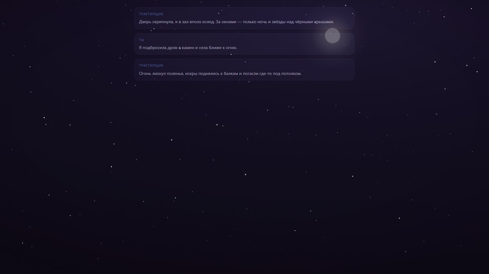
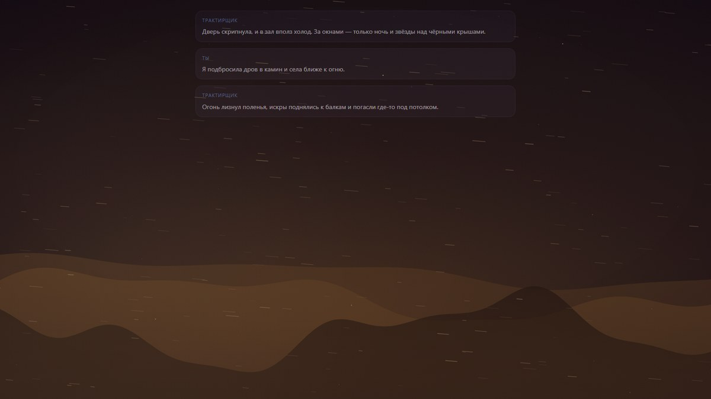
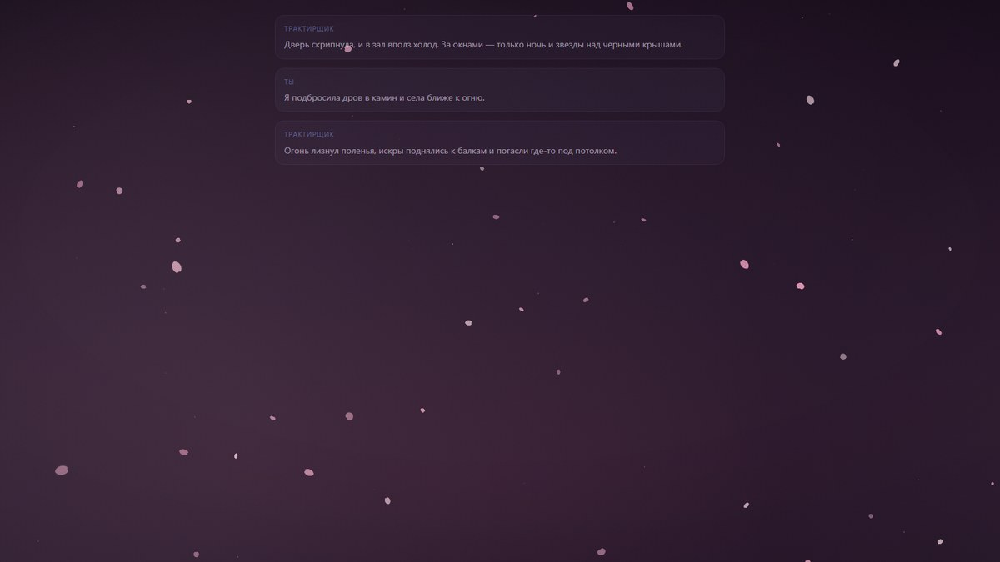

# ✦ MAGIC AURA ✦

**Scene atmosphere & weather for SillyTavern.** Sky, particles and colour live above (or under) your chat: rain, snow, desert sand, falling leaves, sakura petals, fireflies and magical trails with tails.

* [Русский](README.ru.md) · [Українська](README.uk.md) · [Svenska](README.sv.md)

Made with love by **[Selena's Tavern](https://satsvi97.github.io/selena/)**.
Inspired by *Nimbus: Scene Atmosphere* for Tavo — see [CREDITS.md](CREDITS.md). No code or assets from that plugin are used.



## Install

1. Open SillyTavern → **Extensions** (plug icon) → **Install extension**.
2. Paste this URL:

   ```
   https://github.com/satsvi97/magic-aura
   ```

3. Reload the page (F5) and open **Extensions** → **✦ MAGIC AURA ✦**.

Manual install: copy the folder to `SillyTavern/data/<user>/extensions/magic-aura` (or `public/scripts/extensions/third-party/magic-aura` for all users).

Requires SillyTavern **1.12+**. No API, no external requests, nothing is written into your messages.

## Scenes

| id | Name | What's inside |
|---|---|---|
| `night` | Night Silence | stars, dust, a moon disc that follows the hour, rare shooting stars |
| `storm` | Thunderstorm | heavy rain, lightning, low mist |
| `rainy` | Grey Rain | steady rain, overcast sky |
| `snow` | Snowfall | snowflakes, cold haze |
| `fog` | Foggy Morning | mist bands, dust |
| `campfire` | Campfire | embers, warm grade |
| `candle` | Candlelit Room | fine sparks, dim warm light |
| `deep` | Deep Water | bubbles, plankton, blue grade |
| `neon` | Neon Rain | coloured rain, violet grade |
| `starfall` | Starfall | stars, meteors |
| `forest` | Enchanted Forest | fireflies, mist, green grade |
| `desert` | Desert | dunes, blowing sand, heat shimmer |
| `desert_night` | Desert at Night | stars over dunes, cold sand |
| `autumn` | Autumn Leaves | bare branches from the top, falling leaves, warm haze |
| `garden` | Green Garden | green leaves, pollen dust |
| `sakura` | Sakura | petals, pink haze |
| `arcane` | Magic | particles with tails, swirling sparks |
| `cloudy` | Overcast | grey sky, drifting mist |
| `sunny` | Sunny Day | warm light shafts, floating pollen |
| `hail` | Hail | fast hail with bounces, ground mist |
| `blizzard` | Blizzard | sideways snow, dense low mist |
| `aurora` | Northern Lights | procedural aurora curtains, moon, light snow, dust |
| `birthday` | Candles & Cake | candle halo, golden sparks, dust that follows the cursor |




## Scene Panel integration

If [Scene Panel](https://github.com/satsvi97/scene-panel) is installed, Magic Aura reads its scene state
and picks the atmosphere by itself:

| Scene Panel field | What it does |
|---|---|
| `weather` | heavy weather owns the picture: storm, rain, snow, hail, blizzard; overcast / clear only pick the sky when place and time say nothing |
| `place` | picks the look: desert, forest, sea, city, temple/room, garden, sakura, park |
| `timeOfDay` | night → night sky with stars, dawn → fog, sunset → warm light; neutral weather never overrides these |
| `mood` | adjusts the shade: tense/dark darker, tender/calm lighter |

Scene changes fade smoothly: particles cross-fade in ≈0.55 s, the sky in ≈0.8 s.

Nothing is written into Scene Panel, it is read only. Picking a scene manually in the panel or with
`/aura` turns the sync off, so your chosen picture always wins. Turn it back on with
“Sync with Scene Panel”.

Since 0.4.0 the link works both ways: Scene Panel sends `scene-panel:update` after every change and
Magic Aura applies it at once instead of waiting for its 2-second poll. Scene Panel has its own
**“✨ scene background (Magic Aura)”** checkbox, so the sync can be turned on and off from either side.

A small public API for neighbouring extensions:

```js
window.MagicAura.getState();          // { version, scene, syncPanel, … }
window.MagicAura.sync();              // re-read Scene Panel right now
window.MagicAura.setSyncPanel(false); // stop listening to the panel
window.MagicAura.setScene('storm');   // manual pick — pauses the sync
window.MagicAura.open();              // quick scene picker
```

**Any scene, including future ones.** If the weather and place maps don't know a word, Magic Aura
matches it against the `keywords` of every scene in `scenes.js`, so a new scene starts working from
Scene Panel without touching the integration. A scene can also be named outright with the custom
field `аура=…` in the tag: `[[scene: аура=сакура]]` (id, name or any word). It applies right then;
the next weather/place change takes over again.

## Controls

- **Corner button** — quick scene picker (`✕` disables the aura).
- **Extensions → ✦ MAGIC AURA ✦** — scenes, sliders, modes.
- **Slash commands:**

  | command | what it does |
  |---|---|
  | `/aura` | show the current scene |
  | `/aura storm` | switch scene by id or by word ("пустыня", "sakura"…) |
  | `/aura off` | turn the aura off |

  Aliases: `/atmos`, `/аура`, `/атмос`.

## Settings

| control | meaning |
|---|---|
| Density | how many particles |
| Opacity | the whole layer |
| Speed | motion speed |
| Particle size | scale of particles |
| **Scene background** | how strongly the sky gradient covers the chat — the main readability guard, default 45% |
| Shade | black overlay for night / gloomy moods |
| Layer | **background only** (under the chat, default) or **above the chat** (particles over the messages, sky stays behind) |
| Lite mode | half the particles, DPR 1 — for weak devices; also disables parallax |
| Mouse parallax | mist, branches, aurora, crows and dust move in layers with the cursor — desktop only, off on touch |
| React to messages | sending a message throws a gust through leaves and rain, receiving one gives a warm flash and sparks |
| Day cycle | the sky is tinted by the hour from Scene Panel (`sessionHour`, or the time-of-day text) |
| React to text | picks a scene from the message text (at most once per 20 s) |
| Scene per chat | remembers the scene in chat metadata |
| Corner button | show / hide, left or right |
| Layer bounds | diagnostics: pink frame + size label |

## Adding your own scene

`src/scenes.js`:

```js
{
    id: 'my_scene',
    name: 'My Scene',
    icon: '🌑',
    sky: 'night',
    grade: { shade: 1, tint: 'rgba(40,30,80,.16)' },
    layers: [
        { effect: 'stars', params: { count: 120 } },
        { effect: 'motes', params: { color: '200,200,255' }, intensity: 0.6 },
    ],
    keywords: ['word', 'слово'],
}
```

`keywords` are what Scene Panel and “React to text” recognise — a new scene needs nothing else.

An effect lives in `src/effects/*.js`:

```js
registerEffect({
    id: 'my_effect',
    name: 'My Effect',
    blend: 'lighter',            // optional
    create(env) {
        return {
            resize(w, h, dpr) {},
            draw(ctx, t, dt) {},
        };
    },
});
```

## Performance

- One `<canvas>` and one `requestAnimationFrame` for the whole scene.
- Particle count scales with screen area and is capped.
- Sky, grade, vignette and film grain are pure CSS — they cost no frames.
- Pauses on a hidden tab; `prefers-reduced-motion` keeps the sky but drops the motion.
- **Frame limiter:** 60 fps, 40 on touch screens, 30 in Lite, 20 when the window is not focused.
  The loop no longer follows a 165/240 Hz display.
- **Canvas pixel budget ≈ 3.2 Mpx** (Lite / touch: lower DPR), so 4K does not get a huge buffer.
- **Particles are batched:** stars, snow, rain and dust draw in 3–4 paths per frame; mist, shimmer and
  ground fog use pre-built sprites instead of per-frame gradients.
- Touch screens get Lite-level particle counts automatically; weak devices start in Lite.
- DPR is capped at 1.5 (1.25 on touch, 1 in Lite).
- Parallax and message reactions are separate switches, and both are off in Lite / on touch screens: the base picture costs the same as before.
- The day-cycle tint is one CSS overlay that changes once per tick when the hour actually moves.
- Ambient events (crows, occasional meteors) are budgeted and skipped in Lite.

## Credits & licence

- Code: **MIT** — see [LICENSE](LICENSE).
- Art and sound (when added): © Selena's Tavern, all rights reserved.
- Inspired by *Nimbus: Scene Atmosphere* (Tavo). We liked the idea of weather above the chat; the engine, scenes, UI and palette here are written from scratch. No assets are copied.

Made with love by **[Selena's Tavern](https://satsvi97.github.io/selena/)** · [Telegram](https://t.me/+vJVPtuqeHu85ZjU6)
