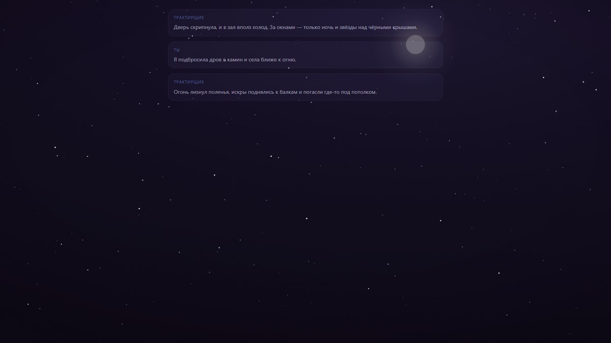
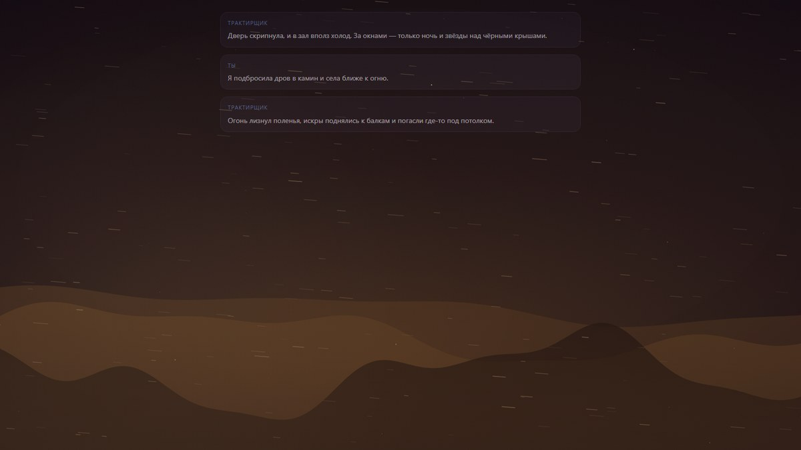
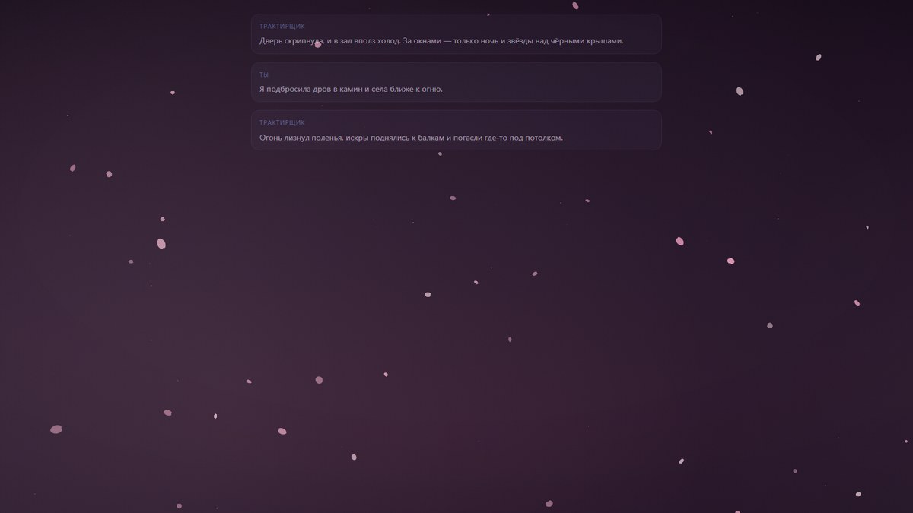

# ✦ MAGIC AURA ✦

**Атмосфера и погода поверх чата для SillyTavern.** Небо, частицы и цвет живут над чатом (или под ним): дождь, снег, песок пустыни, осенние листья, лепестки сакуры, светлячки и магические частицы с хвостами.

* [English](README.md) · [Українська](README.uk.md) · [Svenska](README.sv.md)

Сделано с любовью командой **[Selena's Tavern](https://satsvi97.github.io/selena/)**.
Вдохновлено плагином *Nimbus: Scene Atmosphere* для Tavo — подробности в [CREDITS.md](CREDITS.md). Никакой чужой код и ассеты не использованы.



## Установка

1. SillyTavern → **Расширения** (иконка пазла) → **Установить расширение**.
2. Вставить ссылку:

   ```
   https://github.com/satsvi97/magic-aura
   ```

3. Перезагрузить страницу (F5) и открыть **Расширения** → **✦ MAGIC AURA ✦**.

Вручную: скопировать папку в `SillyTavern/data/<юзер>/extensions/magic-aura` (или в `public/scripts/extensions/third-party/magic-aura`, чтобы для всех юзеров).

Нужен SillyTavern **1.12+**. Никаких API, внешних запросов и правок в сообщениях.

## Сцены

| id | Название | Что внутри |
|---|---|---|
| `night` | Ночная тишина | звёзды, пыль, диск луны с ореолом |
| `storm` | Гроза | тяжёлый дождь, молнии, низкий туман |
| `rainy` | Серый дождь | ровный дождь, пасмурное небо |
| `snow` | Снегопад | снег, холодная дымка |
| `fog` | Туманное утро | полосы тумана, пыль |
| `campfire` | Костёр | искры, тёплый грейд |
| `candle` | Свечная комната | мелкие искры, тёплый полумрак |
| `deep` | Глубина | пузыри, планктон, синий грейд |
| `neon` | Неоновый дождь | цветной дождь, фиолетовый грейд |
| `starfall` | Звездопад | звёзды, метеоры |
| `forest` | Зачарованный лес | светлячки, туман, зелёный грейд |
| `desert` | Пустыня | дюны, летящий песок, марево |
| `desert_night` | Пустыня ночью | звёзды над дюнами, холодный песок |
| `autumn` | Осенний листопад | рыжие листья, тёплая дымка |
| `garden` | Зелёный сад | зелёные листья, пыльца |
| `sakura` | Сакура | лепестки, розовая дымка |
| `arcane` | Магия | частицы с хвостами, искры-вихрь |
| `cloudy` | Облачно | серое небо, ползущий туман |
| `sunny` | Солнечный день | лучи света, пыльца в воздухе |
| `hail` | Град | быстрый град с отскоком, туман у земли |
| `blizzard` | Метель | снег боком, плотная низкая дымка |
| `birthday` | Свечи и торт | ореол свечи, золотые искры |




## Связка со Scene Panel

Если установлен [Scene Panel](https://github.com/satsvi97/scene-panel), Magic Aura читает состояние
сцены и сама выбирает атмосферу:

| поле Scene Panel | что делает |
|---|---|
| `weather` | сильная погода задаёт картинку: гроза, дождь, снег, град, метель; облачно и ясно только выбирают небо, если место и время ничего не говорят |
| `place` | облик по месту: пустыня, лес, море, город, башня/замок/храм/комната, сад, сакура, парк |
| `timeOfDay` | ночь → звёздное небо, рассвет → туман, закат → тёплый свет; нейтральная погода это не перебивает |
| `mood` | правит затемнением: тревожно/мрачно темнее, нежно/спокойно светлее |

Смена сцены идёт плавно: частицы перетекают за ≈0,55 с, небо — за ≈0,8 с.

В Scene Panel ничего не пишется — только чтение. Ручной выбор сцены в панели или командой `/aura`
выключает синхронизацию, чтобы твоя картинка всегда побеждала. Вернуть — галочкой
«Синхронизация со Scene Panel».

С версии 0.4.0 связь работает в обе стороны: Scene Panel после каждого изменения шлёт событие
`scene-panel:update`, и Magic Aura применяет сцену сразу, не дожидаясь опроса раз в 2 секунды.
В самой панели есть галочка **«✨ фон сцены (Magic Aura)»** — включать и выключать синхронизацию
можно с любой стороны.

Небольшое публичное API для соседних расширений:

```js
window.MagicAura.getState();          // { version, scene, syncPanel, … }
window.MagicAura.sync();              // перечитать Scene Panel сейчас
window.MagicAura.setSyncPanel(false); // перестать слушать панель
window.MagicAura.setScene('storm');   // ручной выбор — синхронизация на паузе
window.MagicAura.open();              // быстрый выбор сцены
```

**Любая сцена, включая будущие.** Если погода и место не нашлись в картах, Magic Aura ищет слово
по `keywords` всех сцен из `scenes.js` — новая сцена начинает работать из Scene Panel без правок
интеграции. А ещё сцену можно назвать напрямую доп. полем `аура=…` в теге:
`[[scene: аура=сакура]]` (id, имя или любое слово). Оно срабатывает сразу; следующая смена погоды
или места снова берёт верх.

## Управление

- **Кнопка в углу** — быстрый выбор сцены (`✕` выключает).
- **Расширения → ✦ MAGIC AURA ✦** — сцены, ползунки, режимы.
- **Слэш-команды:**

  | команда | что делает |
  |---|---|
  | `/aura` | что сейчас включено |
  | `/aura гроза` | смена сцены по id или слову |
  | `/aura off` | выключить |

  Алиасы: `/atmos`, `/аура`, `/атмос`.

## Настройки

| что | зачем |
|---|---|
| Плотность | сколько частиц |
| Прозрачность | весь слой целиком |
| Скорость | скорость движения |
| Размер частиц | масштаб частиц |
| **Фон сцены** | насколько сильно небо перекрывает чат — главный предохранитель читаемости, по умолчанию 45% |
| Затемнение | чёрная заливка для ночи и мрачных сцен |
| Слой | **только фон** (под чатом, по умолчанию) или **поверх чата** (частицы над сообщениями, небо остаётся в фоне) |
| Lite-режим | вдвое меньше частиц, DPR 1 — для слабых устройств |
| Реагировать на текст | выбирает сцену по тексту сообщения (не чаще раза в 20 с) |
| Сцена у каждого чата | запоминает сцену в метаданных чата |
| Кнопка на экране | показать/скрыть, слева или справа |
| Границы слоя | диагностика: розовая рамка и размер слоя |

## Как добавить свою сцену

`src/scenes.js`:

```js
{
    id: 'my_scene',
    name: 'Моя сцена',
    icon: '🌑',
    sky: 'night',
    grade: { shade: 1, tint: 'rgba(40,30,80,.16)' },
    layers: [
        { effect: 'stars', params: { count: 120 } },
        { effect: 'motes', params: { color: '200,200,255' }, intensity: 0.6 },
    ],
    keywords: ['слово', 'word'],
}
```

`keywords` — по ним сцену узнают Scene Panel и «Реагировать на текст»; больше для новой сцены ничего не нужно.

Эффект — `src/effects/*.js`:

```js
registerEffect({
    id: 'my_effect',
    name: 'Мой эффект',
    blend: 'lighter',            // необязательно
    create(env) {
        return {
            resize(w, h, dpr) {},
            draw(ctx, t, dt) {},
        };
    },
});
```

## Производительность

- Один `<canvas>` и один `requestAnimationFrame` на всю сцену.
- Число частиц зависит от площади экрана и ограничено сверху.
- Небо, грейд, виньетка и зерно — чистый CSS, кадров не тратят.
- Пауза при скрытой вкладке, `prefers-reduced-motion` оставляет небо без движения, DPR не выше 1.5 (в Lite — 1).

## Кредиты и лицензия

- Код: **MIT** — см. [LICENSE](LICENSE).
- Графика и звук (когда появятся): © Selena's Tavern, все права защищены.
- Вдохновлено плагином *Nimbus: Scene Atmosphere* (Tavo). Идея «погода над чатом» — оттуда, всё остальное (движок, сцены, интерфейс, палитра) написано с нуля. Ассеты не копировались.

Сделано с любовью **[Selena's Tavern](https://satsvi97.github.io/selena/)** · [Telegram](https://t.me/+vJVPtuqeHu85ZjU6)
