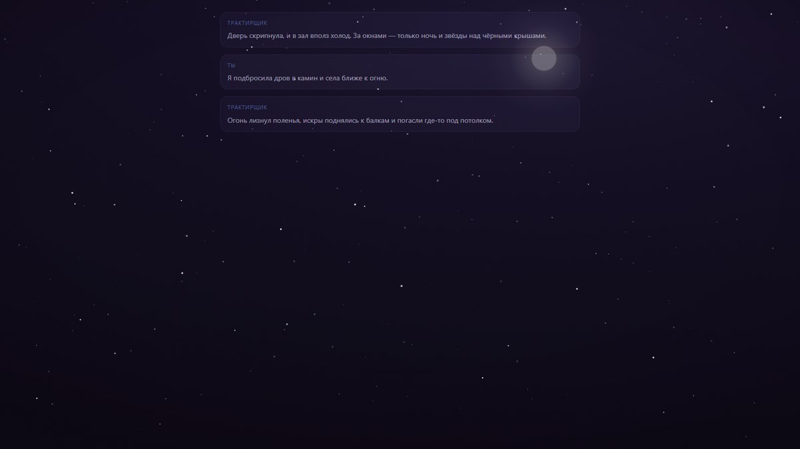
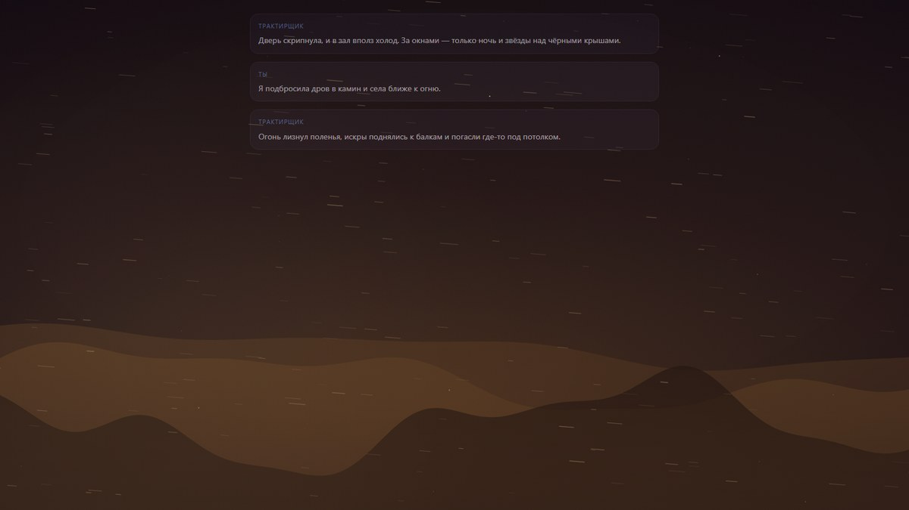
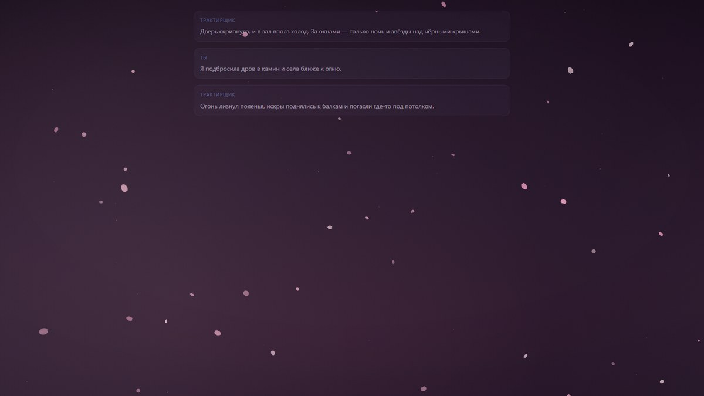

# ✦ MAGIC AURA ✦

**Scenatmosfär och väder ovanför chatten för SillyTavern.** Himmel, partiklar och färg lever över (eller under) chatten: regn, snö, öknens sand, höstlöv, sakurablad, eldflugor och magiska partiklar med svansar.

* [English](README.md) · [Русский](README.ru.md) · [Українська](README.uk.md)

Gjord med kärlek av **[Selena's Tavern](https://satsvi97.github.io/selena/)**.
Inspirerad av *Nimbus: Scene Atmosphere* för Tavo — se [CREDITS.md](CREDITS.md). Ingen kod eller några tillgångar därifrån används.

> **Notis:** svensk översättning är en community-översättning. Rätta gärna formuleringar via issue eller PR.



## Installation

1. SillyTavern → **Extensions** (pusselikonen) → **Install extension**.
2. Klistra in adressen:

   ```
   https://github.com/satsvi97/magic-aura
   ```

3. Ladda om sidan (F5) och öppna **Extensions** → **✦ MAGIC AURA ✦**.

Manuellt: kopiera mappen till `SillyTavern/data/<användare>/extensions/magic-aura` (eller `public/scripts/extensions/third-party/magic-aura` för alla användare).

Kräver SillyTavern **1.12+**. Inget API, inga externa anrop, inget skrivs i dina meddelanden.

## Scener

| id | Namn | Innehåll |
|---|---|---|
| `night` | Nattlig tystnad | stjärnor, stoft, måndisk med gloria |
| `storm` | Åskväder | tungt regn, blixtar, låg dimma |
| `rainy` | Grått regn | jämnt regn, mulen himmel |
| `snow` | Snöfall | snöflingor, kall dis |
| `fog` | Dimrig morgon | dimband, stoft |
| `campfire` | Lägereld | gnistor, varm ton |
| `candle` | Levande ljus | fina gnistor, dämpat varmt ljus |
| `deep` | Djupet | bubblor, plankton, blå ton |
| `neon` | Neonregn | färgat regn, violett ton |
| `starfall` | Stjärnfall | stjärnor, meteorer |
| `forest` | Förtrollad skog | eldflugor, dimma, grön ton |
| `desert` | Öken | dyner, virvlande sand, värmedaller |
| `desert_night` | Öken om natten | stjärnor över dyner, kall sand |
| `autumn` | Höstlöv | fallande löv, varm dis |
| `garden` | Grön trädgård | gröna löv, pollenstoft |
| `sakura` | Sakura | kronblad, rosa dis |
| `arcane` | Magi | partiklar med svansar, virvlande gnistor |
| `cloudy` | Mulet | grå himmel, drivande dimma |
| `sunny` | Solig dag | ljusstrålar, pollen i luften |
| `hail` | Hagel | snabbt hagel med studs, dimma vid marken |
| `blizzard` | Snöstorm | snö i sidled, tät låg dimma |
| `birthday` | Ljus och tårta | ljussken, gyllene gnistor |




## Integration med Scene Panel

Om [Scene Panel](https://github.com/satsvi97/scene-panel) är installerad läser Magic Aura dess
scenläge och väljer atmosfären själv: väder → partiklar, plats → utseende, tid på dygnet → himmel,
ton → nedtoning. Inget skrivs till Scene Panel, det läses bara. Ett manuellt scenval stänger av
synkroniseringen så att din bild alltid vinner.

Sedan 0.4.0 fungerar länken åt båda hållen: Scene Panel skickar `scene-panel:update` vid varje
ändring och Magic Aura tillämpar scenen direkt i stället för att vänta på sin pollning varannan
sekund. Panelen har sin egen kryssruta **"✨ scenbakgrund (Magic Aura)"**, så synken kan slås på
och av från båda håll.

Ett litet publikt API för grann tillägg:

```js
window.MagicAura.getState();          // { version, scene, syncPanel, … }
window.MagicAura.sync();              // läs om Scene Panel nu
window.MagicAura.setSyncPanel(false); // sluta lyssna på panelen
window.MagicAura.setScene('storm');   // manuellt val — pausar synken
window.MagicAura.open();              // snabbvalsmeny
```

**Vilken scen som helst, även framtida.** Om väder- och platskartorna inte känner igen ett ord matchar
Magic Aura det mot `keywords` för alla scener i `scenes.js`, så en ny scen börjar fungera från Scene
Panel utan att integrationen ändras. En scen kan också namnges direkt med det egna fältet `аура=…` i
taggen: `[[scene: аура=сакура]]` (id, namn eller valfritt ord). Det gäller direkt; nästa ändring av
väder eller plats tar över igen.

## Styrning

- **Knappen i hörnet** — snabbval av scen (`✕` stänger av).
- **Extensions → ✦ MAGIC AURA ✦** — scener, reglage, lägen.
- **Slash-kommandon:**

  | kommando | vad det gör |
  |---|---|
  | `/aura` | visar nuvarande scen |
  | `/aura storm` | byter scen via id eller ord |
  | `/aura off` | stänger av |

  Alias: `/atmos`, `/аура`, `/атмос`.

## Inställningar

| kontroll | betydelse |
|---|---|
| Täthet | antal partiklar |
| Opacitet | hela lagret |
| Hastighet | rörelsens fart |
| Partikelstorlek | partiklarnas skala |
| **Scenens bakgrund** | hur starkt himlen täcker chatten — främsta skyddet för läsbarheten, standard 45% |
| Nedtoning | svart överdrag för natt och dystra scener |
| Lager | **endast bakgrund** (under chatten, standard) eller **ovanför chatten** (partiklar över meddelandena, himlen stannar bakom) |
| Lite-läge | hälften så många partiklar, DPR 1 — för svaga enheter |
| Reagera på text | väljer scen utifrån meddelandets text (högst en gång per 20 s) |
| Scen per chatt | sparar scenen i chattens metadata |
| Knapp på skärmen | visa/dölj, vänster eller höger |
| Lagergränser | diagnostik: rosa ram och lagrets storlek |

## Lägga till en egen scen

`src/scenes.js`:

```js
{
    id: 'my_scene',
    name: 'Min scen',
    icon: '🌑',
    sky: 'night',
    grade: { shade: 1, tint: 'rgba(40,30,80,.16)' },
    layers: [
        { effect: 'stars', params: { count: 120 } },
        { effect: 'motes', params: { color: '200,200,255' }, intensity: 0.6 },
    ],
    keywords: ['ord', 'word'],
}
```

`keywords` är det som Scene Panel och "Reagera på text" känner igen — en ny scen behöver inget mer.

En effekt ligger i `src/effects/*.js`:

```js
registerEffect({
    id: 'my_effect',
    name: 'Min effekt',
    blend: 'lighter',            // valfritt
    create(env) {
        return {
            resize(w, h, dpr) {},
            draw(ctx, t, dt) {},
        };
    },
});
```

## Prestanda

- En `<canvas>` och en `requestAnimationFrame` för hela scenen.
- Antalet partiklar skalas efter skärmytan och har ett tak.
- Himmel, ton, vinjett och filmkorn är ren CSS — de kostar inga bildrutor.
- Pausar i dold flik; `prefers-reduced-motion` behåller himlen men tar bort rörelsen; DPR högst 1.5 (1 i Lite).

## Krediter och licens

- Kod: **MIT** — se [LICENSE](LICENSE).
- Grafik och ljud (när de kommer): © Selena's Tavern, alla rättigheter förbehållna.
- Inspirerad av *Nimbus: Scene Atmosphere* (Tavo). Idén med väder ovanför chatten kommer därifrån; motorn, scenerna, gränssnittet och paletten är skrivna från grunden. Inga tillgångar är kopierade.

Gjord med kärlek av **[Selena's Tavern](https://satsvi97.github.io/selena/)** · [Telegram](https://t.me/+vJVPtuqeHu85ZjU6)
