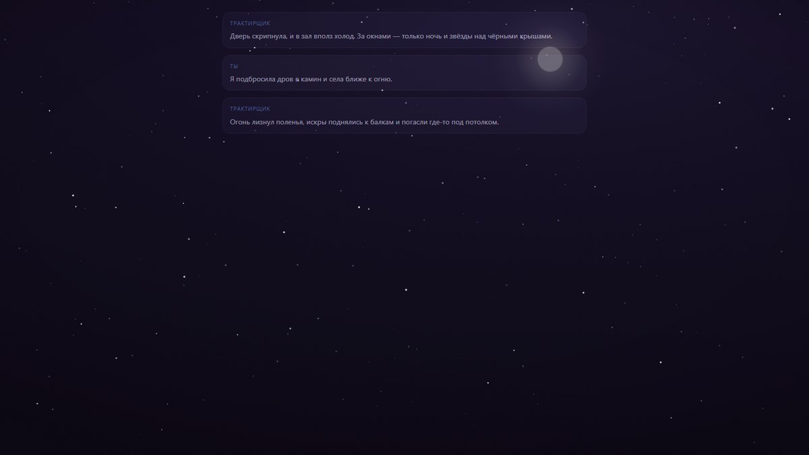
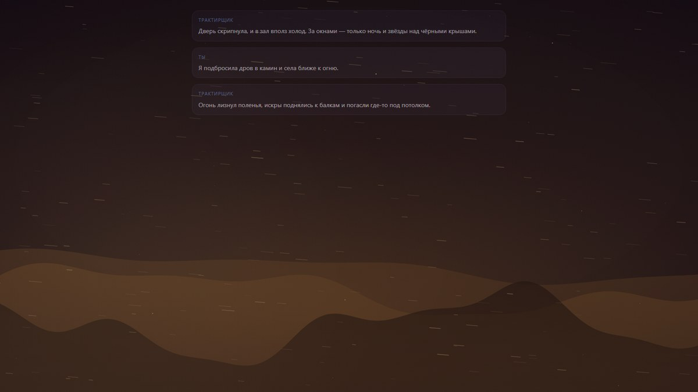
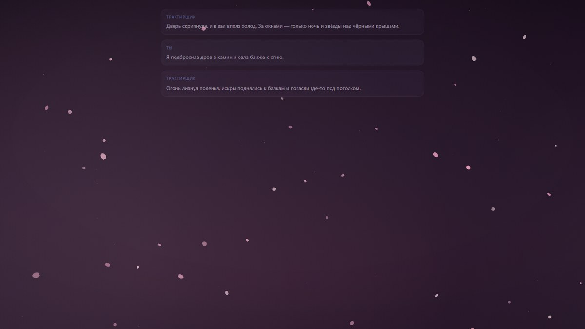

# ✦ MAGIC AURA ✦

**Атмосфера й погода над чатом для SillyTavern.** Небо, частинки та колір живуть над чатом (або під ним): дощ, сніг, пісок пустелі, осінні листя, пелюстки сакури, світлячки й магічні частинки з хвостами.

* [English](README.md) · [Русский](README.ru.md) · [Svenska](README.sv.md)

Зроблено з любов'ю командою **[Selena's Tavern](https://satsvi97.github.io/selena/)**.
Надихнулися плагіном *Nimbus: Scene Atmosphere* для Tavo — деталі в [CREDITS.md](CREDITS.md). Жоден чужий код чи ассети не використані.



## Встановлення

1. SillyTavern → **Розширення** (іконка пазла) → **Встановити розширення**.
2. Вставити посилання:

   ```
   https://github.com/satsvi97/magic-aura
   ```

3. Перезавантажити сторінку (F5) і відкрити **Розширення** → **✦ MAGIC AURA ✦**.

Вручну: скопіювати теку в `SillyTavern/data/<юзер>/extensions/magic-aura` (або в `public/scripts/extensions/third-party/magic-aura` для всіх користувачів).

Потрібен SillyTavern **1.12+**. Без API, зовнішніх запитів і правок у повідомленнях.

## Сцени

| id | Назва | Що всередині |
|---|---|---|
| `night` | Нічна тиша | зорі, пил, диск місяця з ореолом |
| `storm` | Гроза | важкий дощ, блискавки, низький туман |
| `rainy` | Сірий дощ | рівний дощ, похмуре небо |
| `snow` | Снігопад | сніг, холодна димка |
| `fog` | Туманний ранок | смуги туману, пил |
| `campfire` | Багаття | іскри, теплий грейд |
| `candle` | Свічкова кімната | дрібні іскри, теплий напівморок |
| `deep` | Глибина | бульбашки, планктон, синій грейд |
| `neon` | Неоновий дощ | кольоровий дощ, фіолетовий грейд |
| `starfall` | Зорепад | зорі, метеори |
| `forest` | Зачарований ліс | світлячки, туман, зелений грейд |
| `desert` | Пустеля | дюни, летючий пісок, марево |
| `desert_night` | Пустеля вночі | зорі над дюнами, холодний пісок |
| `autumn` | Осінній листопад | руде листя, тепла димка |
| `garden` | Зелений сад | зелене листя, пилок |
| `sakura` | Сакура | пелюстки, рожева димка |
| `arcane` | Магія | частинки з хвостами, іскри-вихор |
| `cloudy` | Хмарно | сіре небо, повзучий туман |
| `sunny` | Сонячний день | промені світла, пилок у повітрі |
| `hail` | Град | швидкий град з відскоком, туман біля землі |
| `blizzard` | Заметіль | сніг боком, щільна низька димка |
| `birthday` | Свічки й торт | ореол свічки, золоті іскри |




## Зв'язок зі Scene Panel

Якщо встановлено [Scene Panel](https://github.com/satsvi97/scene-panel), Magic Aura читає стан сцени
й сама обирає атмосферу: сильна погода → картинка, місце → облик, час доби → небо, тон → затемнення.
Облачно й ясно лише вибирають небо, якщо місце і час нічого не кажуть; ніч, світанок і захід
завжди головніші. Сцена змінюється плавно: частинки ≈0,55 с, небо ≈0,8 с.
У Scene Panel нічого не записується — лише читання. Ручний вибір сцени вимикає синхронізацію,
щоб твоя картинка завжди перемагала.

Від версії 0.4.0 зв'язок працює в обидва боки: Scene Panel після кожної зміни надсилає подію
`scene-panel:update`, і Magic Aura застосовує сцену одразу, не чекаючи опитування раз на 2 секунди.
У самій панелі є галочка **«✨ фон сцени (Magic Aura)»** — вмикати й вимикати синхронізацію
можна з будь-якого боку.

Невелике публічне API для сусідніх розширень:

```js
window.MagicAura.getState();          // { version, scene, syncPanel, … }
window.MagicAura.sync();              // перечитати Scene Panel зараз
window.MagicAura.setSyncPanel(false); // перестати слухати панель
window.MagicAura.setScene('storm');   // ручний вибір — синхронізація на паузі
window.MagicAura.open();              // швидкий вибір сцени
```

**Будь-яка сцена, зокрема майбутні.** Якщо погода й місце не знайшлися в картах, Magic Aura шукає
слово за `keywords` усіх сцен із `scenes.js` — нова сцена починає працювати зі Scene Panel без
правок інтеграції. А ще сцену можна назвати напряму дод. полем `аура=…` у тезі:
`[[scene: аура=сакура]]` (id, ім'я або будь-яке слово). Воно спрацьовує одразу; наступна зміна
погоди чи місця знову бере гору.

## Керування

- **Кнопка в куті** — швидкий вибір сцени (`✕` вимикає).
- **Розширення → ✦ MAGIC AURA ✦** — сцени, повзунки, режими.
- **Слеш-команди:**

  | команда | що робить |
  |---|---|
  | `/aura` | що зараз увімкнено |
  | `/aura гроза` | зміна сцени за id або словом |
  | `/aura off` | вимкнути |

  Аліаси: `/atmos`, `/аура`, `/атмос`.

## Налаштування

| що | навіщо |
|---|---|
| Щільність | скільки частинок |
| Прозорість | увесь шар |
| Швидкість | швидкість руху |
| Розмір частинок | масштаб частинок |
| **Фон сцени** | наскільки небо перекриває чат — головний запобіжник читабельності, типово 45% |
| Затемнення | чорне заливання для ночі та похмурих сцен |
| Шар | **лише фон** (під чатом) або **над чатом** (частинки над повідомленнями, небо лишається позаду) |
| Lite-режим | удвічі менше частинок, DPR 1 — для слабких пристроїв |
| Реагувати на текст | вибирає сцену за текстом повідомлення (не частіше ніж раз на 20 с) |
| Сцена для кожного чату | запам'ятовує сцену в метаданих чату |
| Кнопка на екрані | показати/сховати, ліворуч або праворуч |
| Межі шару | діагностика: рожева рамка та розмір шару |

## Як додати власну сцену

`src/scenes.js`:

```js
{
    id: 'my_scene',
    name: 'Моя сцена',
    icon: '🌑',
    sky: 'night',
    grade: { shade: 1, tint: 'rgba(40,30,80,.16)' },
    layers: [
        { effect: 'stars', params: { count: 120 } },
        { effect: 'motes', params: { color: '200,200,255' }, intensity: 0.6 },
    ],
    keywords: ['слово', 'word'],
}
```

`keywords` — за ними сцену впізнають Scene Panel і «Реагувати на текст»; більше для нової сцени нічого не потрібно.

Ефект — `src/effects/*.js`:

```js
registerEffect({
    id: 'my_effect',
    name: 'Мій ефект',
    blend: 'lighter',            // необов'язково
    create(env) {
        return {
            resize(w, h, dpr) {},
            draw(ctx, t, dt) {},
        };
    },
});
```

## Продуктивність

- Один `<canvas>` і один `requestAnimationFrame` на всю сцену.
- Кількість частинок залежить від площі екрана та обмежена згори.
- Небо, грейд, віньєтка й зерно — чистий CSS, кадрів не витрачають.
- Пауза при прихованій вкладці, `prefers-reduced-motion` лишає небо без руху, DPR не вище 1.5 (у Lite — 1).

## Кредити й ліцензія

- Код: **MIT** — див. [LICENSE](LICENSE).
- Графіка та звук (коли з'являться): © Selena's Tavern, усі права захищені.
- Надихнулися плагіном *Nimbus: Scene Atmosphere* (Tavo). Ідея «погода над чатом» — звідти, усе інше (рушій, сцени, інтерфейс, палітра) написано з нуля. Ассети не копіювалися.

Зроблено з любов'ю **[Selena's Tavern](https://satsvi97.github.io/selena/)** · [Telegram](https://t.me/+vJVPtuqeHu85ZjU6)
